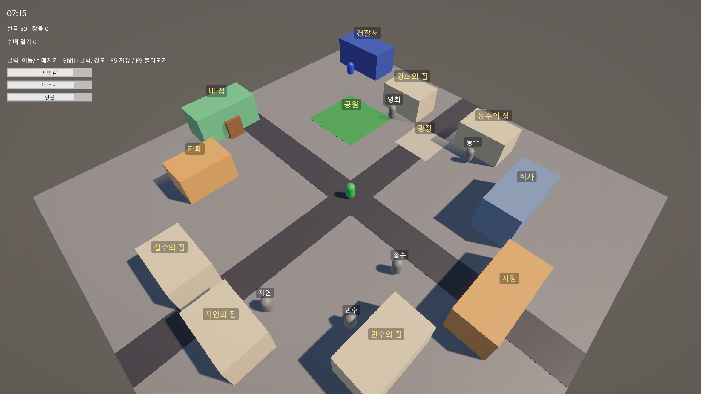
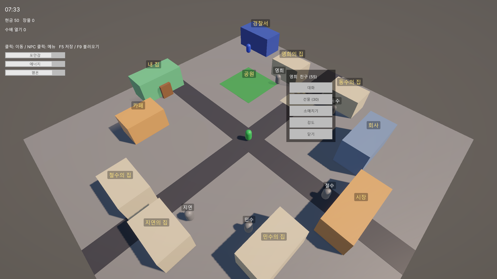
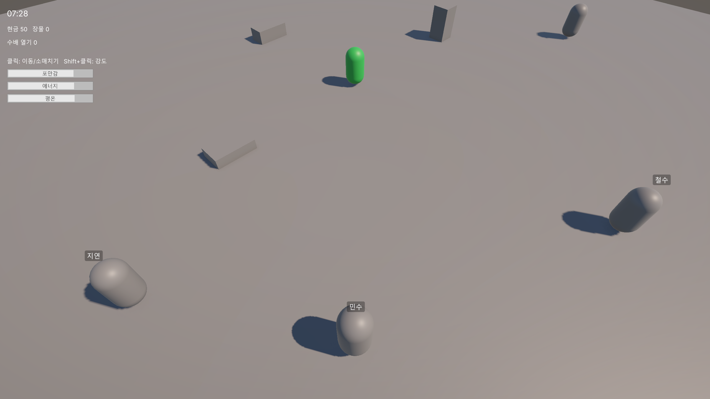

# Crime Life

심즈처럼 생활을 관리하면서, GTA처럼 범죄를 저지르고 쫓기는 **3D 생활 시뮬레이션 + 범죄 액션** 프로토타입입니다.
Unity 6(6000.3.5f2)으로 만들었고, 핵심 루프가 한 바퀴 도는 MVP까지 구현했습니다.







## 핵심 루프

```
욕구 관리 → 타겟 탐색 → 범죄 실행 → 도주 → 장물 처분/정산 → (반복)
```

- 배고픔·피로·스트레스가 쌓이면 범죄 성공률이 떨어집니다. (생활 → 범죄)
- 범죄에 성공하면 장물이 생기지만, 스트레스가 오르고 수배 열기가 올라 경찰이 쫓아옵니다. 실패하면 부상을 입기도 합니다. (범죄 → 생활)
- 잡히면 장물을 전부 압수당하고 벌금을 냅니다. 장물은 처분소에서 현금으로 바꿔야 쓸 수 있습니다.

## 조작법

| 입력 | 동작 |
|---|---|
| 바닥 클릭 | 그 위치로 이동 |
| 냉장고/침대/소파 클릭 | 걸어가서 사용 (욕구 회복, 음식은 현금 20 필요) |
| NPC 클릭 | 메뉴: 대화 / 선물 / 소매치기 / 강도 |
| 주황색 건물 클릭 | 장물 처분 (70%로 현금화) |
| W A S D / Q E / 마우스 휠 / Space | 카메라 이동 / 회전 / 줌 / 플레이어로 복귀 |
| 집에서 B | 건축 모드. 가구 선택 → 클릭으로 놓기, R 회전, 놓인 가구 클릭으로 이동, 우클릭으로 판매 |
| F5 / F9 | 저장 / 불러오기 |

## 구현한 것

- **욕구 시스템**: 포만감·에너지·평온 3종. 위급 구간에 들어가면 범죄 성공률 보정값이 내려갑니다.
- **심즈식 조작**: 탑다운 카메라와 NavMesh 클릭 이동, 가구 상호작용(지속시간 동안 욕구가 점진적으로 변화).
- **범죄 2종**: 소매치기(조용하지만 경계심에 민감)와 강도(수익·위험이 큼). 공통 인터페이스 `ICrimeAction`으로 만들어 새 범죄를 쉽게 추가할 수 있습니다.
- **NPC 5명**: 성격(경계심)·소지금·일과표를 ScriptableObject로 정의한 데이터 기반 NPC. 시간대에 따라 집·직장·카페·공원 등을 오갑니다.
- **수배와 경찰**: 열기가 오르면 경찰이 추격하고, 시간이 지나 식으면 포기합니다. 붙잡히면 벌금과 장물 압수.
- **목격과 쿨다운**: 주변 NPC가 범죄를 보고 신고하면 열기가 더 오르고, 당한 NPC는 일정 시간 경계해서 다시 노릴 수 없습니다.
- **관계**: NPC마다 친밀도(낯선 사람 → 아는 사이 → 친구 → 절친)가 있고, 대화·선물로 쌓습니다. 친한 사람은 경계심이 낮아 털기 쉽지만, 털면 관계가 크게 깨지고 죄책감으로 스트레스가 쌓입니다. 친한 목격자는 신고도 덜 합니다.
- **도시**: 십자 도로 위에 NPC 집, 회사, 카페, 시장, 경찰서, 내 집이 있는 블록아웃 도시입니다. NPC는 일과표대로 건물 앞을 오갑니다. (현재는 박스 + 이름표)
- **집 꾸미기**: 도시와 분리된 집에서 격자 위에 가구를 사서 배치·회전·이동·판매합니다. 가구는 ScriptableObject(크기·가격·프리팹)로 정의되어 모델만 갈아 끼우면 에셋 교체가 끝납니다. 배치는 저장됩니다.
- **장물 처분/정산**: 범죄 수익은 장물로 쌓이고, 처분소에서 수수료를 떼고 현금으로 바꿉니다.

## 코드 구조

```
Assets/_Project/
  Scripts/
    Core/         게임 시계, 카메라 리그, 씬 전환/저장(GameSession)
    Build/        집 꾸미기: 격자 판정(순수 C#), 부지, 건축 모드, 가구 정의
    Needs/        욕구 모델(순수 C#), 설정, 컨트롤러
    Interaction/  가구 상호작용(비용·환전까지 데이터로 정의)
    Player/       클릭 이동
    Crime/        ICrimeAction, 소매치기/강도, 경찰, 지갑, 수배 열기
    NPC/          NPC 프로필(ScriptableObject), 일과표 로직, NPC 추적
    Social/       관계 판정(순수 C#), 친밀도 저장, 대화/선물
    UI/           UI Toolkit HUD, NPC 이름표
  Tests/EditMode/ 순수 로직 단위 테스트
  Data/           밸런스 값(ScriptableObject)
```

설계에서 신경 쓴 점:

- **로직과 MonoBehaviour 분리**: 욕구 계산, 범죄 판정, 일과표 선택, 경찰 상태 전환, 목격 판정은 순수 C#이라 에디터를 띄우지 않고 EditMode 테스트로 검증합니다. (현재 52개)
- **밸런스 값은 코드에 두지 않음**: 감소 속도, 성공률, 벌금 비율 등은 모두 ScriptableObject에서 조정합니다.
- **시스템 간 결합 최소화**: 시스템끼리 직접 부르지 않고 C# event로 통신합니다. UI도 값이 바뀔 때만 갱신하고 매 프레임 폴링하지 않습니다.
- **생활 ↔ 범죄 연결 지점을 명시**: `NeedsModel.GetCrimeModifier()`(생활→범죄), `CrimeOutcome`(범죄→생활)으로 두 시스템이 만나는 곳을 한 군데로 모았습니다.

## 실행 방법

1. Unity **6000.3.5f2**로 이 폴더를 엽니다. (패키지는 자동으로 받아집니다.)
2. `Assets/Scenes/City`(도시)를 열고 Play 합니다. 갈색 문으로 `Home`(집)에 들어갈 수 있습니다. F5 저장 / F9 불러오기.
3. 테스트는 Window → General → Test Runner → EditMode에서 실행합니다.

## 개발 방식

[Claude Code](https://claude.com/claude-code)와 Unity MCP를 사용해 개발했습니다. 작업 규칙은 [CLAUDE.md](CLAUDE.md)에 적어 두었고, 변경마다 컴파일·테스트·플레이 모드 검증을 거쳤습니다.

## 한계와 다음 단계

프로토타입이라 아래는 아직 없습니다.

- 에셋은 기본 도형(캡슐, 큐브)이고 애니메이션이 없습니다.
- 경찰은 1명이고 순찰하지 않으며, 범죄 종류와 가구도 최소한만 있습니다.
- 저장/불러오기, 사운드, 모바일 입력은 구현하지 않았습니다.
